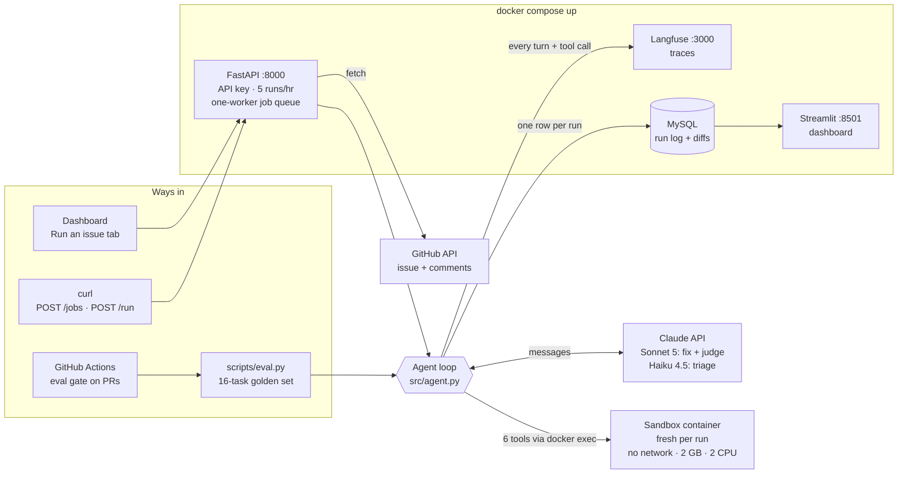
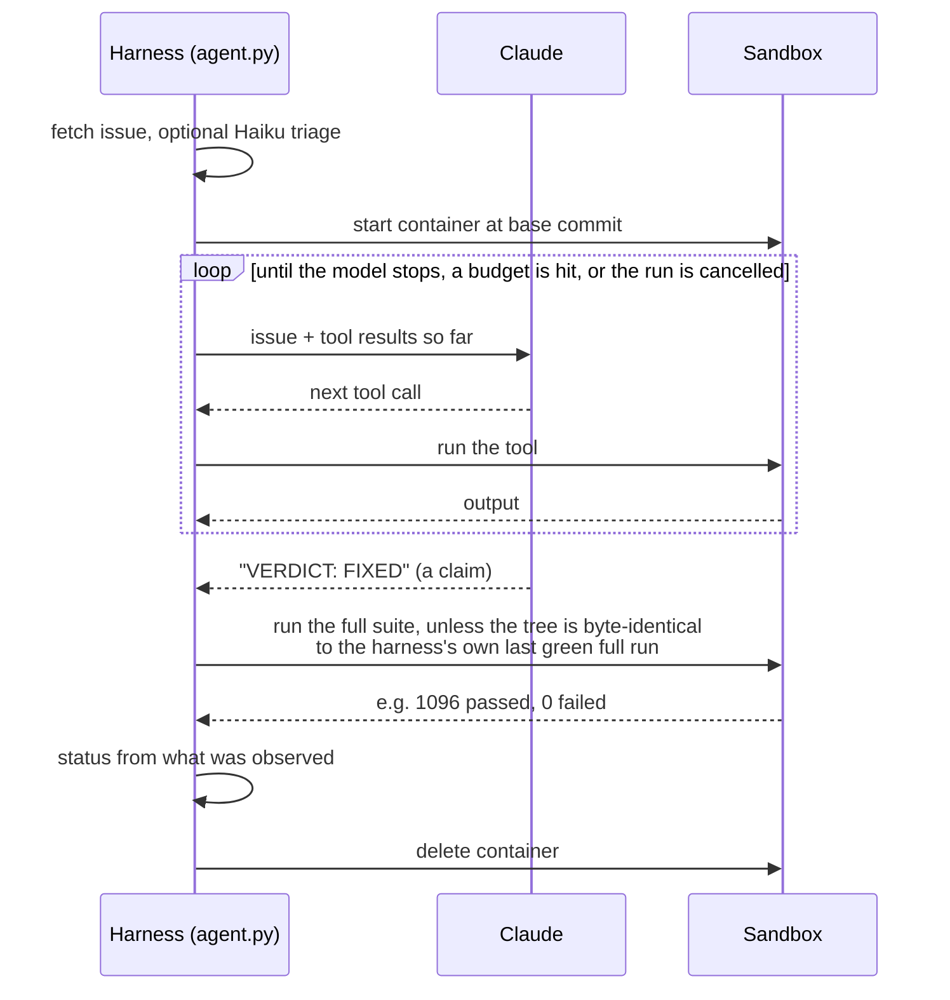

# 🧭 GreenChecker design

The [README](README.md) covers what GreenChecker is and how to start it. This document covers everything else: the design decisions and why they were made, how each part works, how fixes are graded, the full results, what went wrong along the way, and reference material for configuring and running it by hand.

Every number here comes from a file in [results/](results/) and can be recomputed from it.

**Contents**

1. [Design decisions](#-design-decisions)
2. [Architecture](#-architecture)
3. [One run, step by step](#-one-run-step-by-step)
4. [Sandbox and tools](#-sandbox-and-tools)
5. [API and job queue](#-api-and-job-queue)
6. [Run log](#-run-log)
7. [How a fix is graded](#-how-a-fix-is-graded)
8. [Results](#-results)
9. [Cost and latency](#-cost-and-latency)
10. [What broke and how I fixed it](#-what-broke-and-how-i-fixed-it)
11. [Known limits](#-known-limits)
12. [Reference](#-reference): configuration, running issues, command line, tests and CI, repository layout, troubleshooting

---

## 🎯 Design decisions

**1. The harness decides, not the model.**
The model ends with `VERDICT: FIXED`, but that is treated as a claim. The status comes from a test-suite run the harness executed itself. A model that is wrong about its own work, or simply too eager, cannot mark an issue fixed.

**2. Limits live in code, not in the prompt.**
15 tool calls, a 5-minute wall clock, and 3 failed test runs are enforced by the harness ([src/agent.py](src/agent.py)). The prompt mentions them so the model can plan, but nothing depends on the model obeying them.

**3. Every run is isolated and disposable.**
Each run gets a fresh container with no network, capped memory, CPU and process count. It is deleted when the run ends. A bad patch, a runaway test, or a hostile issue can't reach anything outside it.

**4. No orchestration framework.**
The agent loop is written directly against the Anthropic SDK, so every budget check and stopping rule is in one readable file. When a run misbehaves, there is one place to look.

**5. Scoring is separate from execution.**
Every run's diff is saved. Grading re-applies that diff in a fresh sandbox, so changing the grading rules and re-scoring every past run costs $0 in model calls. This is how the eval was corrected without re-running anything (see [What broke](#-what-broke-and-how-i-fixed-it)).

**6. Execution results and opinions are never averaged.**
Test results are facts; the LLM judge's score is an opinion. They are reported side by side. Averaging them would produce a number that means nothing.

**7. Closed by default.**
Every run starts a container on the host's Docker and spends money. So the API refuses all requests until `TRIAGE_API_KEY` is set, allows 5 runs an hour, and runs one at a time.

**8. Tracing is optional.**
With Langfuse off or unreachable, the agent behaves identically. A CI build going red because the observability stack is down would be worse than having no traces.

**9. Spend only on purpose.**
Identical in-flight requests are joined rather than paid for twice. Runs can be cancelled before the next model call. The optional triage check declines only when it is confident (0.8 or above), because the two errors cost very differently: a wrong decline forfeits a fix, while a wrong attempt costs about $0.15.

---

## 🧱 Architecture



Every way in calls the same function, `run_issue()`, so a fix made from the dashboard is produced and checked exactly like one in the eval or in CI.

| Component | Role |
|---|---|
| **API** ([src/api.py](src/api.py)) | Queues runs as background jobs with live progress and cancel, or runs one and waits. Also serves the run log. See [API and job queue](#-api-and-job-queue). |
| **Agent loop** ([src/agent.py](src/agent.py)) | Sends the issue and tool results to Claude, runs the tool calls it asks for, enforces the limits, verifies the result, and decides the status. |
| **Sandbox** ([src/sandbox.py](src/sandbox.py)) | One container per run. See [Sandbox and tools](#-sandbox-and-tools). |
| **Claude** ([src/llm.py](src/llm.py)) | Sonnet 5 writes fixes and judges diffs. Haiku 4.5 runs the optional triage check. The agent's instructions are in [src/prompts.py](src/prompts.py). |
| **Langfuse** ([src/tracing.py](src/tracing.py)) | Records every model turn and tool call, so a failed run can be replayed step by step. |
| **Run log** ([src/store.py](src/store.py)) | One row per run, including the diff. See [Run log](#-run-log). |
| **Dashboard** ([scripts/dashboard.py](scripts/dashboard.py)) | Overview, Run an issue, Run details. Reads the run log directly and starts runs through the API; it never calls Claude itself. |

The API container doesn't run sandboxes itself. It drives the host's Docker through the mounted socket, which is why it requires a key and must not face an untrusted network.

---

## 🔁 One run, step by step



**The loop stops when** the model ends its turn, 15 tool calls are used, 5 minutes pass, 3 test runs have failed, or the caller cancels. A cancelled run skips the final suite run and records the diff so far.

**Verification.** After the loop, the harness takes the full diff and runs the whole suite. It skips that run only when it would repeat one the harness already observed: the model's last full-suite `run_tests` call was green, there has been no edit since, and the sha256 of `git diff --binary` is unchanged. Both guards are needed; the fingerprint also catches a test run that changed tracked files by itself. A red result is never reused. Runs that changed nothing skip the suite, because their status doesn't depend on it. The result's `verification` field records which happened: `rerun`, `reused`, or `none`. `--always-rerun-suite` on the CLI turns reuse off.

**Status** is decided from what was observed:

| Observed | Status |
|---|---|
| Changes made and the full suite is green | `fixed` |
| Changes made but the suite is red, or no changes after trying | `failed` |
| No changes and the model said `SKIP`, or triage declined | `skipped` |
| The caller cancelled | `cancelled` |

**Context management.** The system prompt and tool definitions are cached, and a rolling cache breakpoint sits on the latest message, so each turn re-reads earlier context from cache. Test output, patch errors and write diffs are truncated to 6,000 characters, the model's view of `git_diff` to 12,000, and every tool result to 20,000, so one noisy tool call can't flood the context.

**Progress events.** The loop reports each phase (sandbox start, model turn, tool call, verification, done) with elapsed time and spend so far. The API's job view and the dashboard's progress bar are built from these. An error in the event callback can never break a run.

---

## 🧰 Sandbox and tools

Each run gets one container from the sandbox image, which holds a full clone of the target repository (pyupgrade) with its test dependencies installed:

- checked out at the issue's base commit
- no network
- 2 GB of RAM, 2 CPUs, at most 512 processes

Commands run through `docker exec`, with byte-level input and output so no newline translation can happen (see [What broke](#-what-broke-and-how-i-fixed-it)). The container is force-removed when the run ends, and also at process exit as a fallback.

The model gets six tools ([src/tools.py](src/tools.py)):

| Tool | What it does |
|---|---|
| `read_file` | Returns a file with 1-based line numbers. |
| `grep_code` | Searches tracked files with an extended regex, optionally limited to a path glob. Returns `file:line:text` matches. |
| `write_file` | Overwrites a file in full. Logs the resulting diff before writing. |
| `apply_patch` | Applies a unified diff through a three-rung ladder: `git apply`, then `git apply --recount`, then GNU `patch --fuzz=2`. Reports which rung worked. |
| `run_tests` | Runs pytest on the whole suite or on targets. Returns pass/fail counts and failing test ids. A run that exceeds 120 seconds is reported as a failure, not left hanging. |
| `git_diff` | Returns the working-tree diff, new files included, truncated for the model's view. The harness uses a separate untruncated diff for results and grading. |

Test targets can be a single string (one pytest argument, so node ids containing spaces work) or a list of files.

---

## 🌐 API and job queue

[src/api.py](src/api.py) is a FastAPI service. Both ways of starting a run go through one FIFO queue with exactly one worker, so only one sandbox and one model conversation run at a time:

- `POST /jobs` returns `202` at once. You poll the job for live progress.
- `POST /run` queues the same way, then waits for the result. It is kept for existing clients.

**Submission order.** A request is checked in this order: auth, then issue URL format, then whether an identical job (same issue, base commit, limits and triage setting) is already queued or running. A duplicate joins that job instead of starting a new one. Next come the queue size (at most 10 waiting) and the rate limit (5 runs per hour). Only then is the issue fetched from GitHub, in a worker thread so the server stays responsive. If the fetch fails, or a duplicate appeared in the meantime, the rate-limit slot is given back.

**Cancelling.** A queued job is dropped at once and costs nothing. A running job stops before its next model call; the harness then skips the final suite run and deletes the container.

**Health.** `/health` makes no network calls (the Docker healthcheck hits it every 30 seconds). It reports the worker state, the running job and queue depth. The tracing client is built once per process, in the background at startup, and retried every 60 seconds if Langfuse was unreachable.

All endpoints except `/health` need the header `X-API-Key: $TRIAGE_API_KEY`. Interactive docs are at http://localhost:8000/docs.

| Endpoint | What it does |
|---|---|
| `POST /jobs` | Queue a run; returns a job id and queue position. |
| `GET /jobs/{id}` | Live status: phase, tool calls used, spend so far, event log, and the result when done. |
| `GET /jobs` | Recent jobs, newest first (the last 200 are kept in memory). |
| `DELETE /jobs/{id}` | Cancel a queued or running job. |
| `POST /run` | Same body as `/jobs`, but waits for the run to finish (one to five minutes). |
| `GET /runs`, `GET /runs/{id}` | The run log; the detail view includes the diff. |
| `GET /health` | Queue depth, running job, tracing state. |

Request body for `POST /jobs` and `POST /run`:

| Field | Default | Notes |
|---|---|---|
| `issue_url` | required | `https://github.com/<owner>/<repo>/issues/<n>` |
| `base_ref` | image's latest commit | Needed for closed issues; see [Running issues](#running-issues). |
| `max_tool_calls` | 15 | 1–40 |
| `timeout_s` | 300 | 30–1800 |
| `use_triage` | `false` | Run the ~$0.002 Haiku check first. |

A finished job's `result` has `status`, `stop_reason`, `tool_call_count`, `duration_seconds`, `cost_usd`, `tests_passed`, `tests_failed`, `files_changed`, `model_verdict`, `diff`, `verification`, `trace_url`, `job_id` and `run_id`. For example, from the saved run in [results/phase2/issue-804.json](results/phase2/issue-804.json), an issue that was still open when it ran (fields added in v1.1 and the full diff omitted):

```json
{
  "issue_id": "asottile/pyupgrade#804",
  "status": "fixed",
  "stop_reason": "model_finished",
  "tool_call_count": 10,
  "duration_seconds": 76.4,
  "cost_usd": 0.17814,
  "tests_passed": 1096,
  "tests_failed": 0,
  "files_changed": ["pyupgrade/_plugins/typing_classes.py",
                    "tests/features/typing_classes_test.py"],
  "diff": "diff --git a/pyupgrade/_plugins/typing_classes.py ..."
}
```

`fixed` on an open issue means the suite went green with the agent's patch. There is no maintainer fix to compare against yet, so it is weaker evidence than the golden-set grading below.

---

## 💾 Run log

[src/store.py](src/store.py) writes one row per run:

- **Run details:** issue, source (`api`, `eval`, ...), tag, model, status, resolved flag, stop reason, tool calls, duration, tokens, cost.
- **Test and review results:** passed and failed test counts, judge score.
- **Links and changes:** changed files, trace link, and the diff.

- **Backend:** MySQL when `DATABASE_URL` is set (as under compose); otherwise SQLite at `data/runs.sqlite`, so CI and a fresh checkout need no database.
- **Schema setup** runs once per process per database. Older databases gain new columns in place on first connect, and old rows read the new columns as empty.
- **Diffs** are stored up to 256,000 characters; anything longer is a runaway rewrite, not a patch, and is clipped with a marker.
- **List views** read every column except the diff; the diff is fetched one run at a time.

---

## 📏 How a fix is graded

Three signals, never averaged together:

| Signal | Kind | Catches |
|---|---|---|
| Full suite green | execution | patches that break something else |
| **Maintainer's tests** (upstream oracle) | execution | fixes that satisfy the agent's own test but not the behaviour the maintainer specified |
| LLM judge, 0–3 | opinion | fixes that pass both but suppress a symptom or weaken a test |

There are two grading levels:

- **Lenient** ([scripts/eval.py](scripts/eval.py), and the CI gate): the run says fixed, the suite is green, and the agent's own new test fails without the patch and passes with it.
- **Strict** ([scripts/rescore.py](scripts/rescore.py), applied afterwards): the test files from the maintainer's real fix pass with the agent's patch, the suite is green, and the judge saw no weakened test. This is the SWE-bench criterion, and the headline uses it.

### The golden set

[data/goldenset.verified.json](data/goldenset.verified.json) started as 29 closed pyupgrade issues linked to merged pull requests. Each was checked before use ([scripts/verify_goldenset.py](scripts/verify_goldenset.py), report in [data/goldenset.verified.report.json](data/goldenset.verified.report.json)), and 13 were dropped:

- 10 had a red base commit: their tests use Python 2 literals that Python 3.12's tokenizer rejects.
- 2 had no test in the fix.
- 1 had a maintainer test that already passed before the fix.

Each of the 16 survivors has a green base commit and a maintainer test that fails there. Verification now also rejects a run that is red without any test failing (for example, pytest couldn't find the target), so a broken check can't pass as a real one.

---

## 🏁 Results

From the strict-graded golden-set run [results/eval/20260828T200719Z-9d4fb4b.rescored.json](results/eval/20260828T200719Z-9d4fb4b.rescored.json): Claude Sonnet 5, 15 tool calls per issue.

| Metric | Value |
|---|---|
| Resolved, strict grading | **8 / 16 (50%)** |
| Resolved, lenient grading | 9 / 16 (56%) |
| Agent spend | $2.45 total, $0.15 per run, **$0.31 per resolved fix** |
| Agent + judge spend | $2.57 |
| Run time | 69s median, 80s mean, 171s slowest |
| Tool calls | 12.6 per run on average |

| Outcome | Issues |
|---|---|
| ✅ Resolved | #744, #749, #766, #817, #889, #936, #989, #1042 |
| 🟡 Patched, but the maintainer's tests still fail | #848, #918, #932, #1054 |
| ❌ No patch (ran out of tool calls) | #755, #854, #899, #976 |

One task flipping moves the rate by 6 points, so read these as a small sample.

---

## 💸 Cost and latency

By stop reason, on the strict-graded run:

| stop reason | runs | resolved | mean cost | mean tool calls |
|---|---|---|---|---|
| `model_finished` | 9 | 7 (78%) | $0.126 | 10.8 |
| `tool_budget_exhausted` | 7 | 1 (14%) | $0.188 | 15.0 |

**63% of spend ($1.55 of $2.45) went to runs that resolved nothing.** Runs that hit the tool budget cost about 50% more and resolve 64 points less.

### Triage

The optimization built against that is a ~$0.002 Haiku call that declines hopeless issues before the expensive loop starts ([src/triage.py](src/triage.py)).

- **On the golden set: a negative result.** It declined 0 of 16 and added 1.2% to cost ($2.446 → $2.475). The set only contains issues a maintainer actually fixed, so there is nothing to catch ([results/triage-measurement.json](results/triage-measurement.json)).
- **On 15 open issues: projected −5.4% cost and −6.7% wall clock.** It declined one, #961, correctly: a "what's the rationale for this design" question. The saving is modelled from the mean run ($0.153, 80s); those 15 issues were not actually run ([results/triage-open-issues.json](results/triage-open-issues.json)).

Triage is off by default. Turn it on per run with `"use_triage": true` in the API, or **Triage first** in the dashboard.

### Harness overhead (v1.1)

- The final suite run is skipped when it would repeat the harness's own green run. In a real sandbox, that took a fixed run's harness time from 3.2s to 2.1s on a machine where pyupgrade's suite takes 0.9s. Where the suite takes ~11s, it saves ~11s per fixed run.
- Runs with no changes skip the final suite run entirely.
- The tracing client, database schema setup and GitHub token lookup happen once per process instead of per run or per request.

Details are in the [changelog](CHANGELOG.md).

---

## 🔧 What broke and how I fixed it

**1. Every byte the agent wrote into the container was corrupted.**
Python's `subprocess` text mode translates newlines on *stdin* on Windows. It silently turned every `\n` into `\r\n` inside a Linux container, which corrupted every diff handed to `git apply` and wrote CRLF `.py` files. Fixed by moving the host boundary to bytes ([src/sandbox.py](src/sandbox.py)). **Before: patches rejected over an invisible `^M`. After: 0 CR bytes**, with a permanent check in the smoke test.

**2. `git apply` rejects the diff shape LLMs actually emit.**
After the CRLF fix, a byte-identical hand-written patch *still* failed. I isolated it with a 5-case matrix:

| hunk shape | result |
|---|---|
| 1 context line, insert at end of hunk | rejected |
| 3 context lines, insert at end of hunk | rejected |
| 1 context line **+ 1 trailing context line** | applies |

Any hunk ending on a `+` line with no trailing context is refused, and `--recount` cannot repair it. `apply_patch` became a three-rung ladder (`git apply` → `--recount` → GNU `patch --fuzz=2`) that reports which rung worked. **Worth it because a rejected patch costs 1/15 of the budget**, and traces later showed a run burning 2 calls on exactly this.

**3. The eval was wrong in both directions.**
The first grading used the agent's *own* test to certify a fix. Switching to the maintainer's tests (the SWE-bench criterion) moved the score **9/16 → 8/16** by changing five verdicts:

- Two fixes had been wrongly failed by harness bugs: #744 and #989.
- Three were false positives: #848, #918 and #932. In each, the agent wrote a test its own patch satisfied while the behaviour the maintainer required stayed broken.
- #848 had also **deleted an existing test** instead of making it pass. No execution check flags a deleted test; only the judge did.

**4. The maintainer's tests for #976 never actually ran** (found in v1.1).
#976's fix touched two test files. The harness joined them into one shell-quoted string, so pytest received a single path that does not exist and exited with "file or directory not found". That error looks like a failing test. So verification accepted #976 with zero failing tests, and the strict grader could never pass it, whatever the patch. Test targets are now passed as a list, and verification rejects a red run in which no test failed. Re-checked in a real sandbox, #976 is a valid task (3 maintainer tests fail at its base commit). The score is unchanged.

**Also found and fixed:**
- A prompt rule told the agent to skip "feature requests", when every golden task is actionable by construction. #1054 went from skipped to patched, though its patch still fails the maintainer's tests.
- A `.rej` file from the fuzzy patcher polluted `git_diff` and failed a real fix.
- A `find .` over `.git` turned a working patch into a 60-second timeout.
- A 12,000-character truncation meant for the model's view also cut the saved diff, which would have broken re-grading for large patches.

---

## 🚧 Known limits

- **Runs are nondeterministic.** On a re-run with an identical prompt, #976 went from no patch to a patch the agent believed fixed (it still fails the maintainer's tests). One task flipping moves the rate by 6 points, so the CI gate is set with a wide margin: it catches disasters, not small regressions.
- **The CI gate uses lenient grading.** Strict grading is a separate `rescore.py` step and is not yet wired into CI.
- **n=16 is small.** 10 of the 13 dropped candidates were lost only because their base commits need Python 2-era syntax support; recovering them needs a second sandbox image on an older Python.
- **Issue comments aren't cached** in the golden set, which was built under GitHub's unauthenticated rate limit. #744 and #854 have issue bodies of about 40 characters. #854 fails, possibly from missing context, while #744 resolves anyway.
- **One repository.** Everything so far is measured on pyupgrade; the sandbox image is built for one repository at a time.
- **Not deployed.** The service and its Dockerfiles work locally; no host was chosen. The API drives the host's Docker socket, which is why it is authenticated and must not face an untrusted network.

---

## 📚 Reference

### Configuration

Copy `.env.example` to `.env` and set:

| Variable | What to put there |
|---|---|
| `ANTHROPIC_API_KEY` | Your key from the [Claude Console](https://platform.claude.com/settings/keys). Create it with a workspace selected (the Default workspace is fine). |
| `ANTHROPIC_WORKSPACE_ID` | Only if your key is *not* tied to a workspace: the `wrkspc_...` ID from Settings → Workspaces. Otherwise **delete the line**; a placeholder value makes every call fail. |
| `TRIAGE_API_KEY` | Any secret; the API refuses all requests until it is set. Generate one with `python -c "import secrets; print(secrets.token_urlsafe(24))"` |
| `GITHUB_TOKEN` | Optional. Raises GitHub's limit from 60 to 5,000 issue lookups an hour. Read-only access to public repositories is enough. |
| `LANGFUSE_*` | Already match the Langfuse that compose starts. Set `LANGFUSE_ENABLED=0` to turn tracing off. |
| `DATABASE_URL` | Already points host-side scripts at the compose MySQL. Unset it to use SQLite. |

All optional:
- `TRIAGE_RATE_LIMIT`: runs per window (default 5).
- `TRIAGE_RATE_WINDOW`: window length in seconds (default 3600).
- `TRIAGE_MAX_QUEUE`: maximum waiting jobs (default 10).
- `TRIAGE_API_URL`: where the dashboard finds the API (compose sets it).

Services started by `docker compose up -d --build`:

| Service | Address |
|---|---|
| Dashboard | http://localhost:8501 |
| API | http://localhost:8000 (interactive docs at `/docs`) |
| Langfuse | http://localhost:3000 (`dev@example.com` / `langfuse-dev-password`) |
| MySQL | `localhost:3306` (`triage` / `triage`, database `triage`) |

`docker compose down` stops everything; data is kept in Docker volumes.

### Running issues

The sandbox image holds pyupgrade's latest code, where closed issues are already fixed. For a **closed** issue, pass the commit just before its fix as the base commit (`base_ref`). For an **open** issue, leave it empty. These are known to work:

| Issue | Base commit (`base_ref`) |
|---|---|
| https://github.com/asottile/pyupgrade/issues/749 | `443797a8b190d1f7d0409a2c911257567d6e02ff^1` |
| https://github.com/asottile/pyupgrade/issues/936 | `9a0cad2b8754e7fcc1f0e4681666d06733e51ea5^1` |
| https://github.com/asottile/pyupgrade/issues/766 | `9969644894b1514d941e0c5914f08ec2a3c36416^1` |

Every golden-set issue's base commit is in [data/goldenset.verified.json](data/goldenset.verified.json). A run costs $0.03–$0.36.

```bash
export $(grep '^TRIAGE_API_KEY=' .env)

curl -X POST localhost:8000/jobs -H "X-API-Key: $TRIAGE_API_KEY" \
  -H "content-type: application/json" \
  -d '{"issue_url": "https://github.com/asottile/pyupgrade/issues/749",
       "base_ref": "443797a8b190d1f7d0409a2c911257567d6e02ff^1"}'
# 202 {"id": "3c4b66870f52", "status": "queued", "queue_position": 1, ...}

curl localhost:8000/jobs/3c4b66870f52 -H "X-API-Key: $TRIAGE_API_KEY"
```

### Command line

```bash
pip install -r requirements.txt

python scripts/smoke_test.py            # exercises every tool in a real sandbox, spends nothing
python src/agent.py https://github.com/asottile/pyupgrade/issues/804

python scripts/eval.py --estimate       # cost estimate, spends nothing
python scripts/eval.py                  # full golden set, lenient grading (last run: $2.57)
python scripts/rescore.py results/eval/<run>.json   # strict grading of a saved run, spends nothing

python scripts/backfill_runs.py         # load saved results into the run log
python scripts/backfill_runs.py --refresh   # also fill in diffs for rows logged before v1.1
```

With the compose stack running, these scripts log to the same MySQL and Langfuse, so their runs appear on the dashboard. Without it, unset `DATABASE_URL` and set `LANGFUSE_ENABLED=0`; runs then go to SQLite at `data/runs.sqlite`.

### Tests and CI

```bash
python -m pytest                        # 45 unit tests: no Docker, no API key, ~2s
python scripts/smoke_test.py            # every tool against a real sandbox
```

The unit tests cover:
- the toolbox and its suite-reuse guards
- the agent loop with a scripted model
- the job API: progress, cancel, de-duplication, rate limits and crash recovery
- run-log migrations
- tracer and GitHub caching

**CI** ([.github/workflows/eval.yml](.github/workflows/eval.yml)) runs on pull requests to `main` and pushes to `dev`. It runs the unit tests and the smoke test, then 6 golden-set tasks with lenient grading. It fails the build if:

- the resolve rate falls below 30%,
- the judge's mean score on resolved fixes falls below 2.0, or
- any resolved fix weakens an existing test.

The checks are independent and never averaged. Each CI run costs about $1 in API calls and needs the `ANTHROPIC_API_KEY` repository secret.

### Repository layout

| Path | Contents |
|---|---|
| [src/](src/) | Agent loop, sandbox, tools, API, run log, tracing, GitHub client, grading |
| [scripts/](scripts/) | Dashboard, eval, rescoring, golden-set build and verification, smoke test, backfill |
| [tests/](tests/) | Unit tests |
| [data/](data/) | Golden set and its verification report |
| [results/](results/) | Every saved eval and triage run, versioned for diffing |
| [docs/images/](docs/images/) | Dashboard screenshots used in the README |
| `Dockerfile*`, `docker-compose*.yml` | Sandbox, API and dashboard images; the compose stack, with Langfuse in its own file |

### Troubleshooting

| Symptom | Fix |
|---|---|
| `pull access denied for minio/minio` | MinIO removed its images from Docker Hub in September 2026. [docker-compose.langfuse.yml](docker-compose.langfuse.yml) now uses `cgr.dev/chainguard/minio`, the image Langfuse's own compose file uses. If that pull fails too, start without tracing: `docker compose up -d --build --no-deps sandbox-image mysql api dashboard` |
| Every run fails with a 400 from the Anthropic API | `ANTHROPIC_WORKSPACE_ID` still holds the `wrkspc_...` placeholder. Delete the line, or set it to your real workspace ID. |
| A closed issue finishes with no changes | It ran on the latest code, where the bug is already fixed. Pass its base commit. |
| The dashboard says the API is unreachable | Check `docker compose ps`, and that `TRIAGE_API_KEY` is set in `.env`. |
| `code: command not found` (opening the repo in VS Code) | In VS Code, run **Shell Command: Install 'code' command in PATH** from the command palette. |
